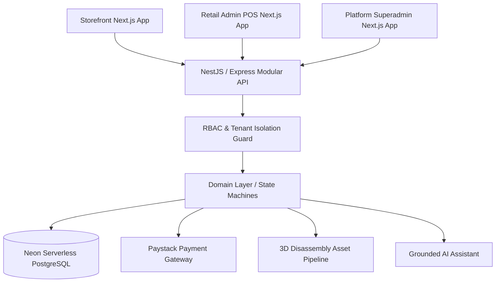

# Gadget Commerce Platform (GCP) - Software Architecture Document

## 1. System Overview
The **Gadget Commerce Platform (GCP)** is a modular multi-tenant SaaS engineered for high-value consumer electronics retailers. It delivers an integrated solution spanning customer-facing e-commerce with real-time 3D cinematic disassembly, physical retail Point-of-Sale (POS), multi-branch inventory control, automated Paystack payment reconciliation, and grounded AI shopping assistance.

---

## 2. Multi-Tenant Data Isolation Model
1. **Explicit Scoping**: All database tables (`products`, `orders`, `stock_ledger`, `branch_inventory`, `payment_intents`) include a foreign key reference to `tenants.id`.
2. **Repository Guarding**: Queries inside `MultiTenantRepository` enforce `tenantId` match on all operations. Cross-tenant access is structurally rejected.
3. **Domain Resolution**: Tenancy is resolved at the edge via domain host, verified tenant header (`x-tenant-id`), or authorized JWT claim.

---

## 3. Core Domain Subsystems
- **Catalog & Compatibility**: Separates global verified hardware models from tenant-specific listings, prices, and stock. Supports exact-model compatibility matching for chargers, cables, and cases.
- **Unified Inventory Ledger**: An append-only ledger (`stock_ledger`) paired with cached balance tables (`branch_inventory`). Atomic stock reservation locks prevent overselling during flash promotions.
- **Paystack Payment Core**: Server-side transaction initialization, HMAC SHA-512 webhook signature verification, and duplicate-event suppression via an immutable `payment_events` table.
- **Cinematic 3D Disassembly Engine**: Client-side WebGL / Three.js viewport driven by scroll progress. Components explode along verified mechanical axes with exact hardware specifications.
- **Grounded AI Assistant**: Answers natural language buyer queries using current inventory and verified specifications, preventing hallucinated prices or specs.
