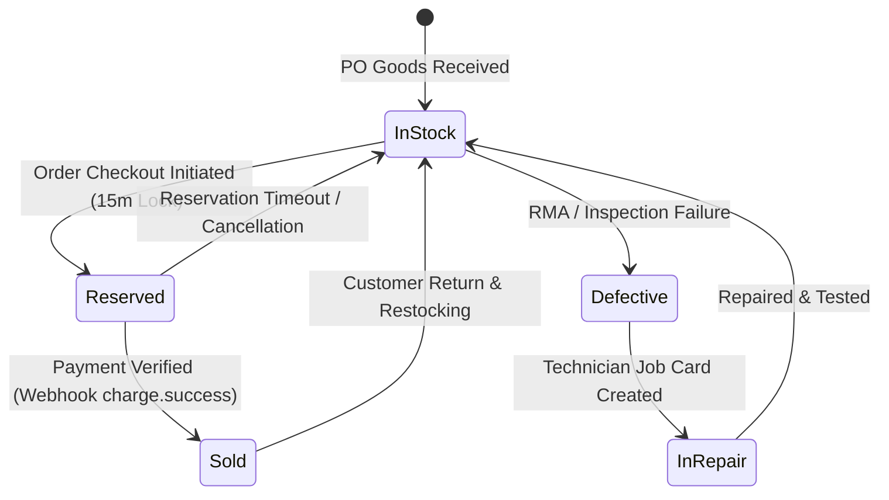

# Inventory & Concurrency Management Architecture

## 1. Inventory State Machine
The inventory engine tracks hardware units through a strict transactional ledger:

---

## 2. Preventing Overselling (ACID Concurrency)
- When a customer proceeds to checkout, `reserveStock(tenantId, branchId, variantId, qty, orderId)` is invoked.
- Available stock is evaluated as:
  $$\text{quantityAvailable} = \text{quantityOnHand} - \text{quantityReserved}$$
- If $\text{quantityAvailable} < \text{requestedQuantity}$, the request is rejected with HTTP 409 and available stock count.
- Once Paystack confirms payment, `commitStockDeduction` atomically decrements both `quantityOnHand` and `quantityReserved`, preserving consistency.
- Serial numbers / IMEIs are tracked individually to prevent duplicates.
